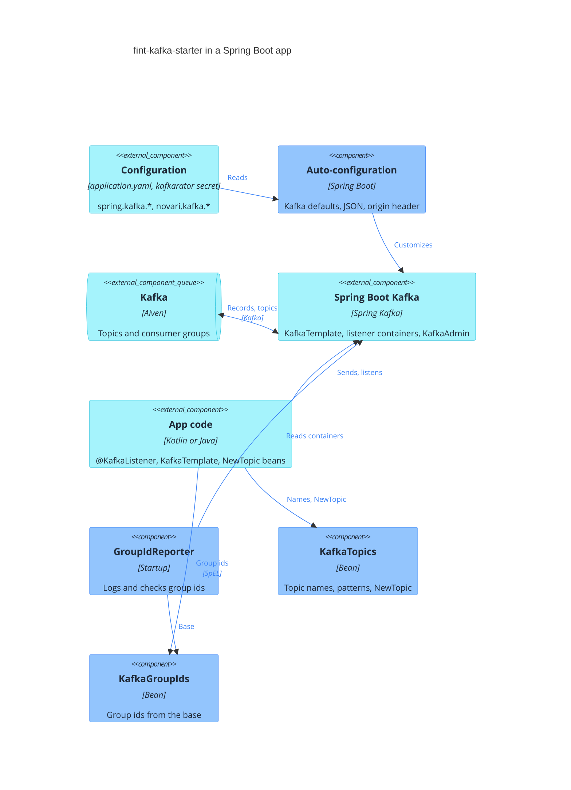

# Architecture

C4 level 3 for fint-kafka-starter. The starter is a library, so it has no system context or containers of its own: it
runs inside each Spring Boot app that depends on it. The diagram shows that app with the starter's components. Blue is
the starter, turquoise is the app, Spring Boot and Kafka.

## C4 level 3: Components

The starter does not send or receive records itself. It adjusts Spring Boot's Kafka beans, and gives the app topic names
and group ids to use with them.

- **Auto-configuration** has two parts:
  - `NovariKafkaDefaultsEnvironmentPostProcessor` adds the `spring.kafka.*` defaults as the property source with the
    lowest precedence. It also sets `client.id` and the origin application id from `novari.kafka.application-id` and
    `novari.kafka.topic.org-id`. See [fint-kafka-starter vs Spring Kafka](fint-kafka-starter-vs-spring-kafka.md).
  - `NovariKafkaAutoConfiguration` runs after Boot's `KafkaAutoConfiguration`. It gives the JSON serializer the app's
    `JsonMapper`, registers the JSON message converter for `@KafkaListener`, and creates `KafkaTopics`, `KafkaGroupIds`
    and `GroupIdReporter`. Every bean the app may replace is `@ConditionalOnMissingBean`.
- **`OriginHeaderProducerInterceptor`** runs inside the Kafka producer, set through `interceptor.classes`, and adds the
  header `origin.application.id` to every record.
- **`KafkaTopics`** builds names from `novari.kafka.topic.org-id` and `domain-context`, and `NewTopic`s with the
  Novari topic config. Boot's `KafkaAdmin` creates them at startup.
- **`KafkaGroupIds`** builds group ids from `spring.kafka.consumer.group-id`, as fint-kafka 6 did. Listeners use it
  through SpEL: `#{@kafkaGroupIds.withSuffix('-cache')}`.
- **`GroupIdReporter`** logs the group id of every container in `KafkaListenerEndpointRegistry` at startup, and checks
  that it starts with `spring.kafka.consumer.group-id` (`novari.kafka.consumer.group-id-check`).

Not in the starter: own producers, consumers or containers, an error handling API, request/reply and Kafka health.
Those are Spring Kafka's, or left out on purpose.
